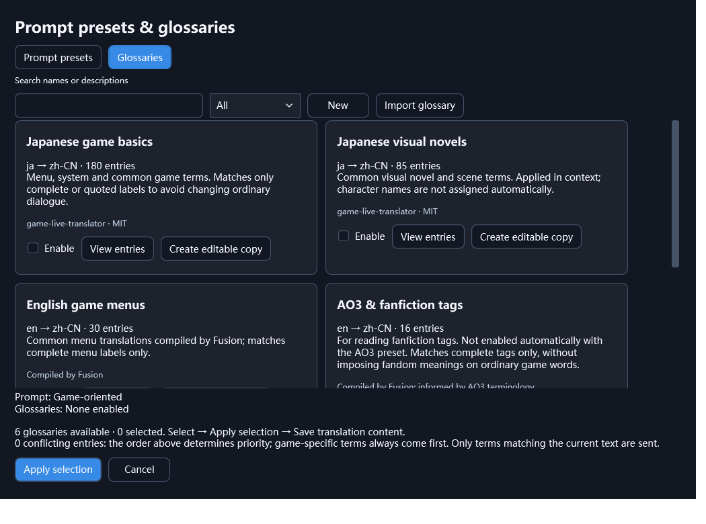

# Game AI Translator · Fusion

[简体中文](README.md) | **English** | [Русский](README.ru.md)

**Translate games on Windows, with your game library, notes and everyday tools in one place.**

Fusion is an open-source game translation and management application for Windows x64. Connect a compatible API or a local model service, display translations through supported engine integrations, or use screenshot OCR to translate text on screen. You can adjust prompts, terminology and fonts, while library information and conversation records are stored locally.

Alongside translation, Fusion includes a game library, rich notes, tags, screenshots, recording, and experimental AI project and Mod tools. If you only need translation, configure a translation profile and import a game; the other tools are optional.

**Current public version: 1.1.165 · Pre-release**

[Download for Windows](https://github.com/zsbnt571/Game-AI-Translator/releases/download/v1.1.165/Fusion-1.1.165.zip) · [Release page](https://github.com/zsbnt571/Game-AI-Translator/releases/tag/v1.1.165) · [Full release notes](docs/RELEASE-NOTES-1.1.165.md)

## What you can do

- **Translate games:** read text and display translations through supported engine integrations. Compatible games can have text extracted and translated in advance, then reuse the cache at launch. The translation manager supports terminology, manual edits and selective retries.
- **Translate screenshots:** capture a screen region, recognize its text with OCR and translate it independently of an engine integration. This is separate from saving game screenshots or recording video.
- **Choose prompts and glossaries:** select a translation preset, combine glossary packs or use per-game terms. Inspect entries, create editable copies and import your own packs. Translation trials help compare wording and terminology.
- **Adjust fonts and character settings:** choose and preview fonts per game, check for missing characters and restore defaults. Where dialogue can be attributed reliably, character profiles and gender hints assist grammatical agreement in supported target languages.
- **Organize your library:** launch and manage games, browse by engine, real folder or custom category, save guides and links in formatted long notes, and filter or batch-tag your games.
- **Capture screenshots and video:** save game-window PNG screenshots and MP4 recordings, organized by game. Configure shortcuts under **Settings → Keys**; the media window does not need to be open. Recording is currently silent.
- **Try settings in the test workspace:** compare translation APIs, presets and glossary packs, inspect elapsed time and matched terms, preview fonts and dialogue layout, and run capture, engine, character and cache diagnostics. Trial results do not enter the official game cache.
- **Use experimental AI tools:** work with Codex or OpenCode for chat, coding and project-file analysis, linking a game when needed. The workspace supports conversations, attachments, execution activity and approvals, plus supported numeric tools and text-file Mod management.

## Interface preview

The prompt and glossary manager lets you inspect entries, combine packs or create your own versions.

*Actual 1.1.165 interface with example configuration; no personal game library, conversations or credentials are shown.*

## Download and get started

1. Download **Fusion-1.1.165.zip** above, extract the entire folder to a writable location and run **GameTranslator.exe**.
2. Configure a compatible API or an already-running local model service under **Settings → Translation profiles**, then test the connection.
3. Select the source-language scope, target language, prompt preset and optional glossary packs, and save the translation-content settings.
4. Import a game and use its available translation mode, or use screenshot translation directly. To compare results first, open a translation trial in the test workspace.

The package includes the desktop .NET, Python and OCR components, but **no large language model or API credit**. Access and charges depend on your chosen provider. Some web features require the Windows WebView2 Runtime.

For everyday use, download the application package from Releases. **Code → Download ZIP** at the top of the repository downloads source code, not a ready-to-run application.

## Latest update · 1.1.165

The cumulative changes since the previous public version, 1.1.128, include:

- Expanded game-font integrations, character profiles and gender assistance, with improved caching and status messages.
- Six scenario prompt presets, six glossary packs with 369 entries, custom imports and translation-comparison trials.
- Rich game notes, tag browsing, batch tagging, real-folder navigation and compact context menus.
- Game screenshots and silent video recording, with capture shortcuts consolidated in settings.
- Reorganized settings and test tools, plus improvements to experimental AI conversations, projects and Mod workflows.
- Monochrome/original engine icons and size previews, and a fix for the maximized AI workspace layout.
- Completed nine-language coverage for recent interfaces, notifications and errors.

[Full changes and limitations](docs/RELEASE-NOTES-1.1.165.md) · [Validation scope](docs/VALIDATION-1.1.165.md) · [Previous releases](https://github.com/zsbnt571/Game-AI-Translator/releases)

## Compatibility and experimental features

The interface supports Simplified Chinese, Traditional Chinese, English, Japanese, Korean, Spanish, French, German and Russian. Interface language and translation target language are configured separately. Bundled glossary packs currently focus on English/Japanese to Simplified Chinese.

Game compatibility depends on the engine version and text components, not just the engine name. A successful font preview or diagnostic example does not verify rendering in the original game. Character gender assistance currently targets grammatical agreement in English, Spanish, French, German and Russian.

AI tools remain experimental. The selected permission mode determines what they can access or change, and operations may affect game files or saves; back them up before making changes. The built-in Mod manager currently handles supported standalone UTF-8 text files. Generic CE memory scanning, integrated F95 browsing, upscaling/DLSS and recording audio are not implemented.

Version 1.1.165 passed **3,967 controlled checks with zero failures, covering 207 UI states**. This round did not repeat original-game sessions, live translation API requests or AI generation, and does not establish that every game, model or Mod has been tested.

## Data storage and upgrading

Default storage is inside the software folder: general data in `data`, conversations in `AI chat`, screenshots in `data/screenshot` and recordings in `data/video`. Existing custom locations continue to follow their configuration; folder shortcuts are grouped under **Settings → Storage locations**. When you use an online service, submitted content is processed by your chosen provider.

Before upgrading, exit Fusion through its tray menu, back up the entire old folder and extract the new package separately. Preserve your data and custom-location settings when migrating, and do not run two versions against the same data. Public packages contain no personal keys, library records or chats. Windows-protected keys may need to be entered again after moving to a different Windows account.

## Source, building and feedback

`Source/` contains the application and engine integrations; `tools/` contains build and check tools; `docs/` holds documentation; and `licenses/` and `third-party-source/` provide dependency licenses and corresponding source. A directory's commit date reflects its last change, so not every directory needs to share the latest release date.

Developers can download [Fusion-1.1.165-Source.zip](https://github.com/zsbnt571/Game-AI-Translator/releases/download/v1.1.165/Fusion-1.1.165-Source.zip) and follow the [build instructions](docs/BUILD.en.md). GitHub's generated source archives omit some binary build inputs. The published desktop application was rebuilt; unchanged auxiliary components were reused and hash-verified. A complete clean-machine rebuild of every auxiliary component remains unverified.

Project-owned code is **GPL-3.0-only**; dependencies retain their own licenses. See the [third-party notices](THIRD_PARTY_NOTICES.md). Submit reproducible problems or suggestions through [Issues](https://github.com/zsbnt571/Game-AI-Translator/issues), including the version, steps and any necessary sanitized logs.
