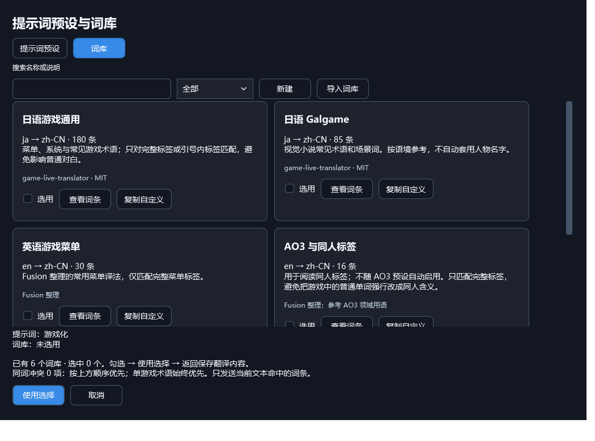

# Game AI Translator · Fusion

**简体中文** | [English](README.en.md) | [Русский](README.ru.md)

**在 Windows 上翻译游戏，并把游戏资料、笔记和常用工具放在一起。**

Fusion 是一款面向 Windows x64 的开源游戏翻译与管理软件。你可以选择自己的兼容 API 或本地模型服务，用支持的引擎适配在游戏中显示译文，也可以通过截图 OCR 翻译屏幕上的文字。提示词、术语和字体可以按需求调整，游戏资料与聊天记录保存在本地。

除了翻译，Fusion 还整合了游戏库、长笔记、标签、截图录像，以及实验性的 AI 项目与 Mod 工具。只需要翻译时，配置翻译方案并导入游戏即可；其他工具可按需使用。

**当前公开版本：1.1.165 · 预发布版**

[下载 Windows 软件包](https://github.com/zsbnt571/Game-AI-Translator/releases/download/v1.1.165/Fusion-1.1.165.zip) · [查看发布页](https://github.com/zsbnt571/Game-AI-Translator/releases/tag/v1.1.165) · [完整更新记录](docs/RELEASE-NOTES-1.1.165.md)

## 主要功能

- **游戏翻译**：通过已适配的引擎读取文本并显示译文。支持的游戏可提前提取文本、准备译文并复用缓存；译文管理支持术语、人工修订和所选内容补译。
- **截图翻译**：截取屏幕区域，通过 OCR 识别文字并翻译，适用于需要独立于引擎使用的场景。它与保存游戏截图、录像是不同的功能。
- **提示词与词库**：选择翻译预设，搭配多个词库或单游戏术语；可查看、复制自定义并导入词库。临时试译可以帮助你比较表达方式与术语效果。
- **字体与角色设置**：按游戏选择字体、预览、检查缺字和恢复默认。具备可靠台词归属的适配可以使用角色资料与性别提示，辅助需要性别语法一致性的目标语言。
- **游戏库、笔记与标签**：集中启动和管理游戏，使用引擎、真实文件夹或自定义分类浏览；保存攻略、链接和格式化长笔记，并按标签筛选、批量标记游戏。
- **截图与录像**：保存游戏窗口 PNG 截图和 MP4 录像，按游戏管理文件。快捷键集中在“设置 → 按键”，使用时无需先打开媒体窗口；当前录像无声音。
- **测试区**：对比翻译 API、预设和词库，查看耗时与命中术语；预览字体与对白排版，并进行截图录像自检及引擎、角色、缓存诊断。试译结果不写入正式游戏缓存。
- **AI 工具（实验功能）**：使用 Codex 或 OpenCode 进行聊天、编程和项目文件分析，按需要关联游戏；支持会话、附件、执行过程与批准操作，以及受支持的数值工具和文本文件 Mod 管理。

## 界面预览

提示词与词库管理：可以查看词条、组合选用词库，或创建自己的版本。

*以上为 1.1.165 使用示例配置的实际界面，不含个人游戏库、聊天或密钥。*

## 下载与快速开始

1. 从上方下载 **Fusion-1.1.165.zip**，完整解压到可写目录，运行 **GameTranslator.exe**。
2. 在“设置 → 翻译方案”配置兼容 API，或已经运行的本地模型服务，然后测试连接。
3. 选择原文范围、目标语言、提示词预设与需要的词库，保存翻译内容。
4. 导入游戏，使用该游戏可用的翻译方式；也可以直接使用截图翻译。想先比较效果，可进入测试区试译。

软件包包含桌面所用的 .NET、Python 与 OCR 组件，**不包含大语言模型或 API 额度**。服务访问及费用由所选提供方决定；部分网页功能需要 Windows WebView2 Runtime。

普通用户请下载 Release 中的软件包。仓库上方 **Code → Download ZIP** 下载的是源码，不是可直接运行的软件。

## 最新更新 · 1.1.165

相对上一个公开版本 1.1.128，本次累计更新主要包括：

- 扩展游戏字体适配、角色资料管理与性别增强，并改进相关缓存和状态提示。
- 加入六个场景提示词预设、六个词库（369 条词条）、自定义导入和翻译对比试用。
- 完善游戏长笔记、标签浏览、批量标签、真实文件夹导航和紧凑右键菜单。
- 加入游戏截图与无声录像，将媒体快捷键统一到设置。
- 整理测试区与设置，完善实验性 AI 会话、项目和 Mod 工作区。
- 增加引擎图标黑白/原色与大小预览，修复 AI 页面最大化布局。
- 补齐近期功能的九语言界面、通知和错误提示。

[查看完整累计更新与限制](docs/RELEASE-NOTES-1.1.165.md) · [查看本版验收范围](docs/VALIDATION-1.1.165.md) · [历史版本](https://github.com/zsbnt571/Game-AI-Translator/releases)

## 兼容范围与实验功能

界面支持简体中文、繁體中文、English、日本語、한국어、Español、Français、Deutsch、Русский。界面语言和游戏译文语言分别设置；内置词库目前主要面向英/日译简体中文。

游戏支持取决于引擎版本和文字组件，不能仅凭引擎名称保证兼容。字体预览和诊断样例通过，也不等于原游戏已经验收。角色性别增强目前主要用于英语、西班牙语、法语、德语和俄语的语法一致性。

AI 工具仍是实验功能：权限模式决定可访问和修改的范围，操作可能影响游戏文件或存档，修改前请备份。内置 Mod 管理目前面向受支持的独立 UTF-8 文本文件；通用 CE 内存扫描、F95 内置浏览、超分辨率/DLSS 和录像音频尚未实现。

1.1.165 完成 **3,967 项受控检查，0 失败，覆盖 207 个界面状态**。本轮未重新执行真实游戏、翻译 API 或 AI 生成测试，不代表所有游戏、模型和 Mod 都已实测。

## 数据保存与升级

默认数据保存在软件子目录：普通资料在 `data`，聊天在 `AI chat`，截图在 `data/screenshot`，录像在 `data/video`。已有自定义位置继续按配置使用；目录入口集中在“设置 → 存储位置”。使用在线服务时，所提交的内容会交给你选择的服务处理。

升级前从托盘退出 Fusion，备份整个旧目录，再单独解压新包。迁移时保留自己的数据及自定义位置设置，不要让两个版本同时使用同一份数据。公开软件包不含个人密钥、游戏库或聊天记录。跨 Windows 账户迁移后，系统加密保护的密钥可能需要重新输入。

## 源码、构建与反馈

`Source/` 保存程序与引擎适配源码，`tools/` 为构建及检查工具，`docs/` 为说明，`licenses/` 和 `third-party-source/` 保存依赖许可与对应源码。目录旁的提交时间表示该项最后一次修改时间，不要求所有目录与最新版本同一天更新。

开发者可下载 [Fusion-1.1.165-Source.zip](https://github.com/zsbnt571/Game-AI-Translator/releases/download/v1.1.165/Fusion-1.1.165-Source.zip)，并阅读[构建说明](docs/BUILD.md)。GitHub 自动生成的源码压缩包不包含全部二进制构建输入。当前发布版重建了主程序；未改辅助组件按哈希复用，全部辅助组件在干净机器从源码完整重建仍未验收。

项目自有代码采用 **GPL-3.0-only**，依赖遵循各自许可证，见[第三方声明](THIRD_PARTY_NOTICES.md)。问题和建议可提交到 [Issues](https://github.com/zsbnt571/Game-AI-Translator/issues)，请附上版本、复现步骤及必要的脱敏日志。
