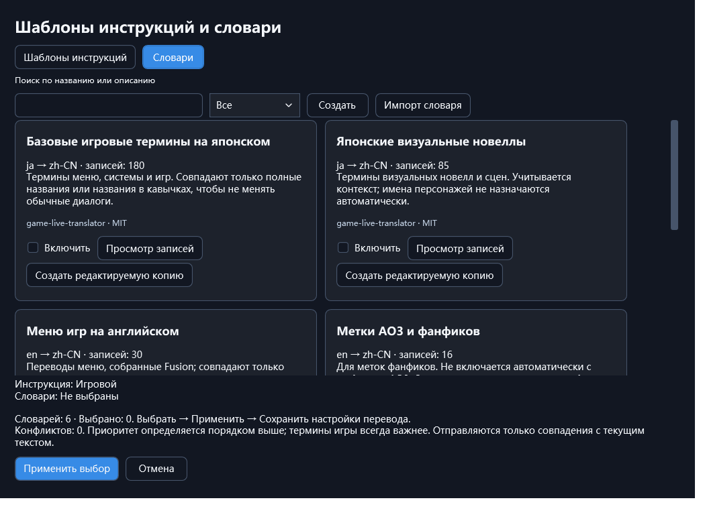

# Game AI Translator · Fusion

[简体中文](README.md) | [English](README.en.md) | **Русский**

**Переводите игры в Windows и храните библиотеку, заметки и полезные инструменты в одном приложении.**

Fusion — приложение с открытым исходным кодом для перевода и организации игр в Windows x64. Подключите совместимый API или локальный сервис языковой модели, выводите перевод через поддерживаемую интеграцию с движком либо распознавайте текст на экране с помощью OCR. Инструкции для перевода, терминологию и шрифты можно настраивать; сведения о библиотеке и история диалогов сохраняются локально.

Помимо перевода, Fusion включает библиотеку игр, форматируемые заметки, метки, снимки экрана, запись видео и экспериментальные инструменты ИИ для проектов и модификаций. Если нужен только перевод, достаточно настроить профиль и импортировать игру. Остальные инструменты используются по желанию.

**Текущая публичная версия: 1.1.165 · Предварительный выпуск**

[Скачать для Windows](https://github.com/zsbnt571/Game-AI-Translator/releases/download/v1.1.165/Fusion-1.1.165.zip) · [Страница выпуска](https://github.com/zsbnt571/Game-AI-Translator/releases/tag/v1.1.165) · [Полный список изменений](docs/RELEASE-NOTES-1.1.165.md)

## Основные возможности

- **Перевод игр:** чтение текста и вывод перевода через поддерживаемые интеграции с движками. В совместимых играх текст можно извлечь и перевести заранее, а затем использовать кэш при запуске. Менеджер переводов поддерживает терминологию, ручные исправления и повторный перевод выбранных записей.
- **Перевод снимков экрана:** захват области экрана, распознавание текста с помощью OCR и перевод независимо от интеграции с движком. Это отдельная функция, не связанная с сохранением игровых снимков или записью видео.
- **Шаблоны инструкций и словари:** выбор готового шаблона, сочетание нескольких словарей и терминология для отдельной игры. Можно просматривать записи, создавать редактируемые копии и импортировать свои словари. Пробный перевод помогает сравнить формулировки и применение терминов.
- **Шрифты и персонажи:** выбор шрифта для каждой игры, предварительный просмотр, проверка отсутствующих символов и восстановление стандартных настроек. При надёжно установленном авторстве реплик сведения о персонажах и подсказки о поле помогают согласовывать перевод в поддерживаемых целевых языках.
- **Библиотека, заметки и метки:** запуск и организация игр, просмотр по движку, реальной папке или своей категории, сохранение руководств и ссылок в форматируемых заметках, фильтрация и массовое назначение меток.
- **Снимки и видео:** сохранение окна игры в PNG и запись MP4 с группировкой файлов по игре. Горячие клавиши настраиваются в разделе клавиш; окно медиа открывать заранее не нужно. Пока видео записывается без звука.
- **Тестовая область:** сравнение API, шаблонов и словарей, просмотр времени запроса и совпавших терминов, проверка шрифтов и расположения реплик, самопроверка захвата, диагностика движков, персонажей и кэша. Результаты пробного перевода не попадают в основной кэш игры.
- **Инструменты ИИ — экспериментальные:** Codex или OpenCode для диалогов, программирования и анализа файлов проекта, с привязкой игры при необходимости. Доступны история диалогов, вложения, ход выполнения и подтверждения действий, а также поддерживаемые инструменты работы с числовыми значениями и текстовыми модификациями.

## Пример интерфейса

В менеджере инструкций и словарей можно просматривать записи, сочетать словари и создавать собственные варианты.

*Реальный интерфейс 1.1.165 с примером настроек; личная библиотека, диалоги и ключи не показаны.*

## Загрузка и первый запуск

1. Скачайте **Fusion-1.1.165.zip** по ссылке выше, полностью распакуйте архив в доступную для записи папку и запустите **GameTranslator.exe**.
2. В настройках профилей перевода укажите совместимый API или уже работающий локальный сервис модели и проверьте подключение.
3. Выберите исходные языки, целевой язык, шаблон инструкций и нужные словари, затем сохраните настройки содержимого перевода.
4. Импортируйте игру и используйте доступный для неё способ перевода либо сразу перейдите к переводу снимков экрана. Для сравнения результатов сначала можно выполнить пробный перевод в тестовой области.

Пакет включает компоненты .NET, Python и OCR для приложения, но **не содержит большой языковой модели или средств на API-счёте**. Доступ и стоимость зависят от выбранного провайдера. Некоторым веб-функциям требуется Windows WebView2 Runtime.

Для обычного использования скачивайте пакет приложения из Releases. Кнопка **Code → Download ZIP** вверху репозитория загружает исходный код, а не готовую к запуску программу.

## Последнее обновление · 1.1.165

Основные накопленные изменения относительно предыдущей публичной версии 1.1.128:

- Расширены интеграции игровых шрифтов, профили персонажей и подсказки для согласования по полу; улучшены кэширование и сообщения о состоянии.
- Добавлены шесть сценарных шаблонов инструкций, шесть словарей с 369 записями, импорт собственных словарей и сравнение пробных переводов.
- Улучшены длинные заметки, просмотр и массовое назначение меток, навигация по реальным папкам и компактные контекстные меню.
- Добавлены игровые снимки и запись видео без звука; горячие клавиши собраны в настройках.
- Переработаны настройки и тестовые инструменты, улучшены экспериментальные диалоги ИИ, проекты и работа с модификациями.
- Добавлены монохромные и исходные цвета значков движков с просмотром размера; исправлена компоновка развёрнутого окна ИИ.
- Дополнен перевод новых интерфейсов, уведомлений и ошибок на девять языков.

[Полные изменения и ограничения](docs/RELEASE-NOTES-1.1.165.md) · [Область проверки](docs/VALIDATION-1.1.165.md) · [Предыдущие выпуски](https://github.com/zsbnt571/Game-AI-Translator/releases)

*Подробные примечания к выпуску и отчёт о проверках доступны на китайском и английском.*

## Совместимость и экспериментальные функции

Интерфейс поддерживает упрощённый и традиционный китайский, английский, японский, корейский, испанский, французский, немецкий и русский. Язык интерфейса и целевой язык перевода задаются отдельно. Встроенные словари пока в основном рассчитаны на перевод с английского и японского на упрощённый китайский.

Совместимость зависит от версии движка и текстовых компонентов, а не только от названия движка. Успешный предварительный просмотр шрифта или диагностический пример не подтверждает правильное отображение в самой игре. Подсказки о поле персонажей сейчас предназначены главным образом для грамматического согласования на английском, испанском, французском, немецком и русском.

Инструменты ИИ остаются экспериментальными. Режим разрешений определяет доступные действия; они могут затрагивать файлы игры и сохранения, поэтому перед изменениями нужна резервная копия. Встроенный менеджер модификаций пока работает с поддерживаемыми отдельными текстовыми файлами UTF-8. Универсальное сканирование памяти CE, встроенный просмотр F95, повышение разрешения/DLSS и запись звука не реализованы.

Версия 1.1.165 прошла **3 967 контролируемых проверок без ошибок с охватом 207 состояний интерфейса**. В этом цикле повторно не проверялись исходные игры, реальные запросы к API перевода или генерация ИИ. Это не означает, что проверены все игры, модели и модификации.

## Хранение данных и обновление

По умолчанию данные находятся внутри папки программы: основные сведения — в `data`, диалоги — в `AI chat`, снимки — в `data/screenshot`, видео — в `data/video`. Заданные пользователем расположения продолжают действовать; ссылки на папки собраны в настройках хранения. При использовании онлайн-сервиса отправленное содержимое обрабатывает выбранный вами провайдер.

Перед обновлением завершите Fusion через меню в трее, сохраните копию всей старой папки и распакуйте новый пакет отдельно. При переносе сохраните свои данные и настройки расположения; не запускайте две версии с одним каталогом данных. Публичные пакеты не содержат личных ключей, библиотеки или диалогов. После перехода на другую учётную запись Windows защищённые системой ключи может потребоваться ввести заново.

## Исходный код, сборка и обратная связь

В `Source/` находятся приложение и интеграции с движками, в `tools/` — средства сборки и проверки, в `docs/` — документация. Папки `licenses/` и `third-party-source/` содержат лицензии зависимостей и соответствующие исходники. Дата коммита у папки показывает её последнее изменение: не все папки обязаны обновляться в день выпуска.

Разработчики могут скачать [Fusion-1.1.165-Source.zip](https://github.com/zsbnt571/Game-AI-Translator/releases/download/v1.1.165/Fusion-1.1.165-Source.zip) и воспользоваться [инструкциями по сборке](docs/BUILD.ru.md). Автоматические архивы исходников GitHub не содержат всех двоичных входных файлов сборки. Основное приложение опубликованного выпуска пересобрано; неизменённые вспомогательные компоненты использованы повторно с проверкой хешей. Полная сборка всех вспомогательных компонентов из исходников на чистой системе пока не подтверждена.

Собственный код проекта распространяется по **GPL-3.0-only**; зависимости сохраняют свои лицензии. См. [уведомления о сторонних компонентах](THIRD_PARTY_NOTICES.md). Об ошибках и предложениях сообщайте в [Issues](https://github.com/zsbnt571/Game-AI-Translator/issues), указывая версию, шаги воспроизведения и необходимые журналы без личных данных.
